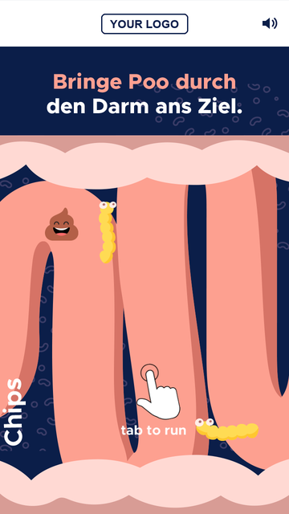
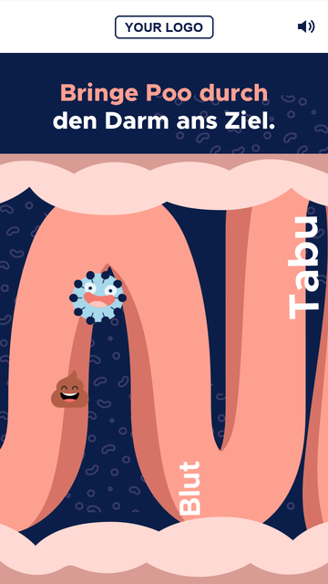
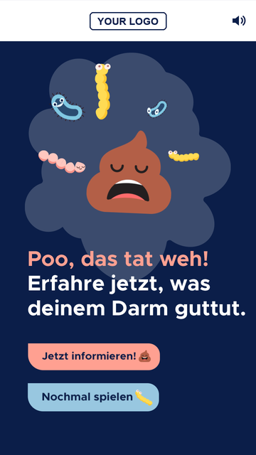
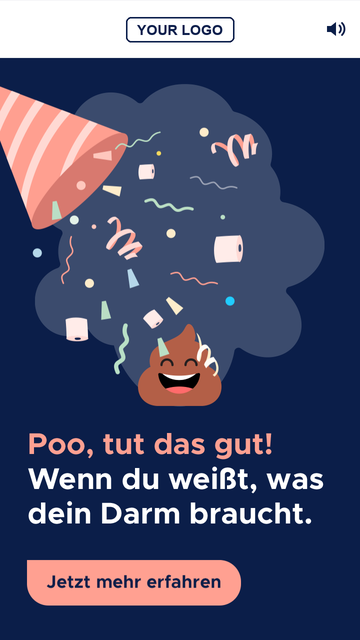
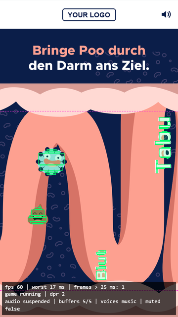
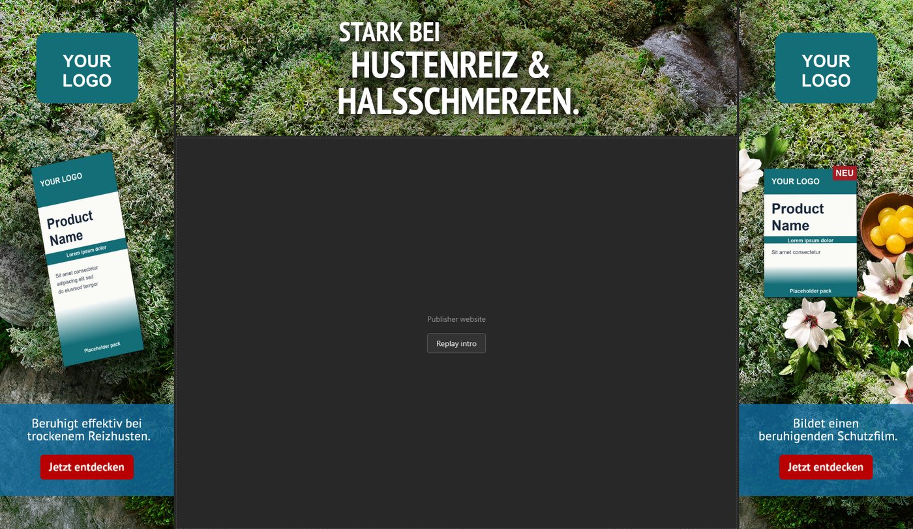
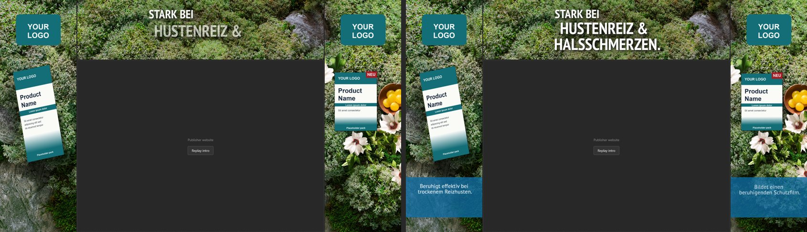
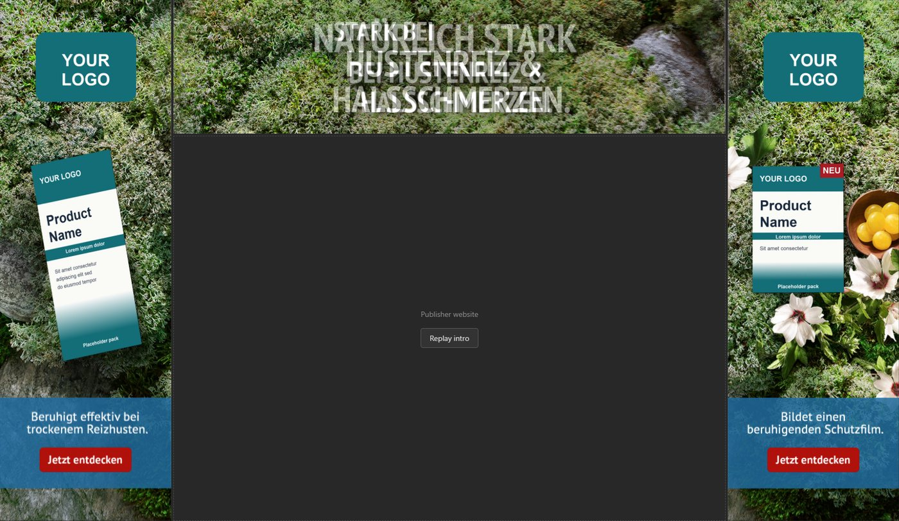

# We The Folks take-home: Gut Run and Fireplace

**Two rich media ads in plain HTML, SCSS and modern JavaScript (GSAP for animation, no frameworks): a mobile tap-to-jump mini game ("Gut Run") and a three-part animated desktop skin ("Fireplace"). Task: Junior Frontend Engineer, SF-FE-01-BAM.**


🇬🇧 English | [🇵🇱 Polski](README.pl.md)

The reasoning behind the main choices is in [DECISIONS.md](DECISIONS.md).

---

## The two ads

| Variant | Folder | Format | Shipped weight (limit 3 MB) |
| --- | --- | --- | --- |
| **A: Gut Run**, mobile game | [`variant-a-game`](variant-a-game) | 360×640 CSS px design, scaled to the phone | **1.45 MB** |
| **B: Fireplace**, desktop skin | [`variant-b-fireplace`](variant-b-fireplace) | top 1032×250, left and right 320×975 CSS px | **0.50 MB** left, **0.55 MB** right, **0.83 MB** top |

---

## Run it locally

Requires Node.js 18 or newer (tested on 24). The compiled CSS is committed, so `npm install` only fetches the static server and Sass.

```bash
cd variant-a-game        # or: cd variant-b-fireplace
npm install
npm start
```

| Variant | URL | Extras |
| --- | --- | --- |
| A | <http://localhost:3000> | `?debug=1` draws hitboxes and a small HUD (fps, worst frame, audio state) |
| B | <http://localhost:3000/preview.html> | `?debug=1` overlays `design/layout.png` at 50% (key `O` toggles it); **Replay intro** button |

For Variant A on a phone, open your computer's LAN address (for example `http://192.168.1.10:3000`). Audio needs a server, because browsers block `fetch` on `file://`. After editing SCSS run `npm run build:css`.

---

## Variant A: Gut Run

A fullscreen mobile ad with a Flappy-Bird-style game. The player guides a smiling poo through a stylised gut and dodges 15 obstacles (bacteria and words such as "Stress" and "Tabu"). Each obstacle appears exactly once per run.

<p>
  
  &nbsp;
  
  &nbsp;
  
  &nbsp;
  
</p>

- **Start and gameplay**: animated intro, first tap starts the run after a short "get ready" rewind. Fixed player position, tap to jump, gravity, scroll speed ramping from 100 to 130 px/s.
- **Fair collisions**: hitboxes come from each sprite's alpha mask, not its bounding box. Over 108,000 tested positions, no death happened more than 2 px from a visible touch.
- **Endcards**: fail (CTA and replay) and win (confetti, CTA), with eased, staggered entrances. Replay resets everything: no leftover timers, doubled speed or duplicated sounds.
- **Sound** (Web Audio API): music loop, crash, fail, cheer and applause, started only after the first gesture, with a remembered mute toggle.
- **Pause** on `visibilitychange` for the game, sound and animations.
- **Responsive**: scales to any phone viewport (320×568 up to 430×932) without distortion. `prefers-reduced-motion` replaces decorative animation with the final state.

**Debug mode** (`?debug=1`) draws the hitboxes:



**Checked on:** Android Infinix Note 30 Pro in Chrome (60 fps, worst frame 17 ms, a few dropped frames at the start while sprites decode), iPhone in Safari (works, including sound), and desktop Chrome with CPU throttling and bot players (win, fail, replay, pause, reduced motion).

---

## Variant B: Fireplace

Three separate creatives (`top.html`, `left.html`, `right.html`) that frame a publisher's website. `preview.html` shows them side by side in iframes, like `design/layout.png`, with an empty area for the website.



- **Pixel-accurate layout**: layers sit at the position and 50% size of the 2x assets, and the CTA position was measured from the design.
- **Continuous background**: the pre-cut backgrounds keep the product as in the design, and thin strips cut from `bg-big.jpg` are blended in at the seams so the moss reads as one surface (details in [DECISIONS.md](DECISIONS.md#variant-b-fireplace)).
- **Intro** (about 4.6 s, the three parts in sync): background zoom, logos, text panel, copy, a headline built line by line, CTA last. Only `transform` and `opacity` are animated.
- **Idle loop**: a slow background drift and a soft CTA pulse that stop after 30 seconds, when the GSAP ticker goes to sleep.
- **Synchronised start** across the three documents through `postMessage` (`?sync=1`, used by the preview). Opened alone, a part starts immediately.
- **Clickout** on the whole part, **`prefers-reduced-motion`** (final state at once), **pause** when the tab is hidden, and a preview that scales itself to the window.

**Intro, two moments:**



**Debug overlay** (`?debug=1`), the design at 50% on top of the build:



---

## Known issues and shortcuts

**Both**
- No automated tests. I verified with headless Chrome scripts, real phones (Variant A) and manual checks.
- No JavaScript build step: plain scripts loaded in order, to keep the ads small. Compiled CSS is committed.
- Click tags were tested only with the default URL, not in a real ad server.

**Variant A**
- Designed for portrait phones. In landscape or on a tablet the game keeps its 9:16 shape with navy sides.
- The obstacle course is fixed (hand-tuned and validated), so every run is the same.

**Variant B**
- **The top headline asset does not match the design.** `layout.png` reads "NATÜRLICH STARK / BEI HUSTENREIZ & / HALSSCHMERZEN.", the supplied `top/hl.png` reads "STARK BEI / HUSTENREIZ & / HALSSCHMERZEN.". I used the asset as supplied, so the debug overlay shows the two headlines overlapping.
- **Several PNG-8 assets had no transparency** (`box.png`, `cta.png`, both `hl.png`). `tools/fix-alpha.py` restores it. The panel opacity (0.8) and the copy's anti-aliasing were reconstructed, so they are close, not exact.
- **`bg-big.jpg` does not match the pre-cut backgrounds** (different grading and product), so it is used only for the seam strips.
- **The product is baked into the background**, so it cannot slide in alone; the background zoom and fade carry the intro.
- The seam strips are static while the background below them zooms, so slight movement may be visible inside their 64 px blend zone.
- The 4 px gap between parts in the preview is an assumption from the width of `bg-big.jpg` (1680 px).
- Tested only in Chrome, not in Safari or Firefox.

---

## What I would do next

- Add Playwright tests: a bot that wins and loses Variant A, and frame-timing checks for both ads.
- Variant A: several obstacle courses, a difficulty ramp across levels, a landscape layout, lighter music (it is half of the ad's weight).
- Variant B: ask the designer for a clean background without the product so it can slide in on its own, replace the damaged PNG-8 files with proper exports, pause ads that scroll out of view.
- Package each ad as its own zip, test the click tags in a real ad server, and check Safari and Firefox.

---

## AI note

I planned the steps and decisions myself and used **Claude Code** for the implementation: scaffolding, tooling (the alpha-mask hitbox generator, the course checker, headless Chrome scripts that play the game and take screenshots) and reviewing my own code. I read and tested everything it produced.

Where it was wrong, and what I fixed:
- **The first jump killed the player.** There was no headroom at the start, so the first tap hit the top bound. I added a separate, gentler `startVelocity`.
- **A hand-made obstacle course was too dense** to pass fairly. I replaced it with an optimiser and a validator (`tools/check-course.py`) that checks every gap against the physics.
- **Text hitboxes were unfair.** A pixel-versus-rectangle analysis showed deaths far from any touch, so I regenerated them.
- **A wrong size claim.** It said the music would push Variant A over 3 MB, but it was already counted. I measured the real weight with a script.
- **The Variant B background.** The assumption that `bg-big.jpg` is just the three backgrounds put together was false: stitching the pre-cut files showed a seam, and `bg-big.jpg` has a different product. I used a hybrid (see [DECISIONS.md](DECISIONS.md#variant-b-fireplace)).

---

## Tech stack and structure

| Layer | Technology |
| --- | --- |
| Markup and logic | HTML5, ES6+ JavaScript (plain scripts), no framework |
| Styles | Sass (SCSS), BEM (`block__element--modifier`), compiled CSS committed |
| Animation | GSAP 3.15 (`vendor/gsap.min.js`, standard license) |
| Audio | Web Audio API (Variant A) |
| Tooling | `sass`, `serve`; Python with Pillow for the asset tools |

```
.
├─ variant-a-game/
│  ├─ index.html · css/ · scss/ · js/ · assets/ · vendor/
│  ├─ tools/               # gen-hitboxes.py, check-course.py
│  └─ design/              # target screens (not shipped)
├─ variant-b-fireplace/
│  ├─ left.html · right.html · top.html · preview.html
│  ├─ css/ · scss/ · js/ · assets/ · vendor/
│  ├─ tools/               # fix-alpha.py, slice-seams.py
│  └─ design/              # layout.png (not shipped)
├─ docs/images/            # README screenshots
├─ README.md · README.pl.md
└─ DECISIONS.md · DECISIONS.pl.md
```

`design/`, `tools/` and `bg-big.jpg` are not referenced by any ad, so they are not part of its weight.
