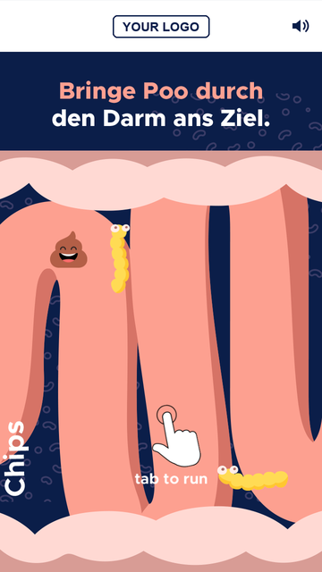
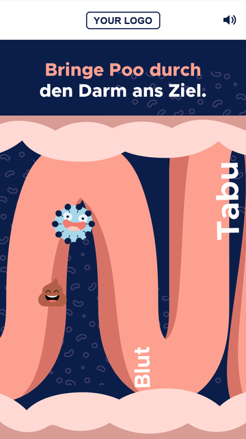
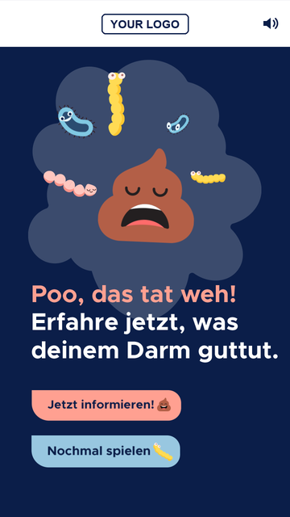
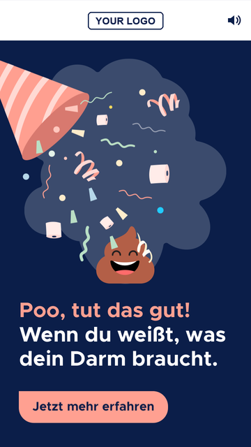
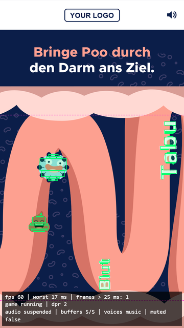
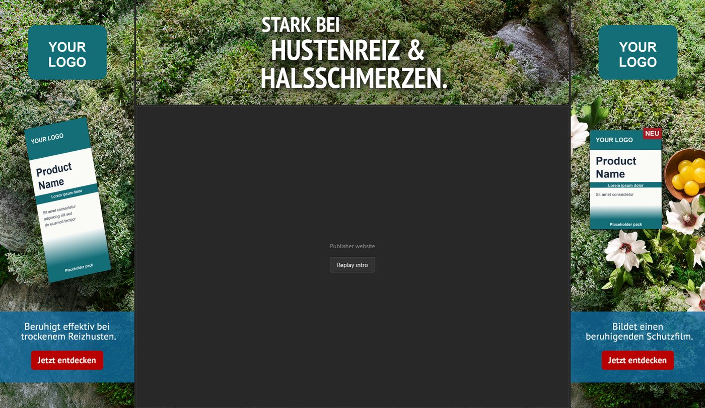
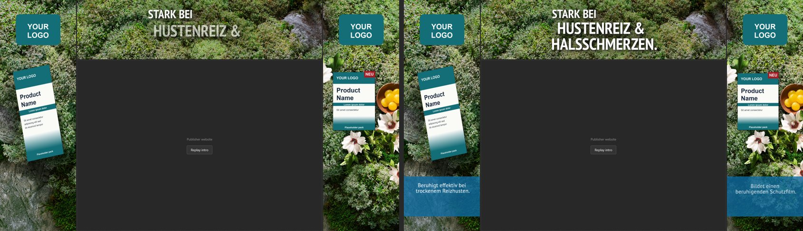
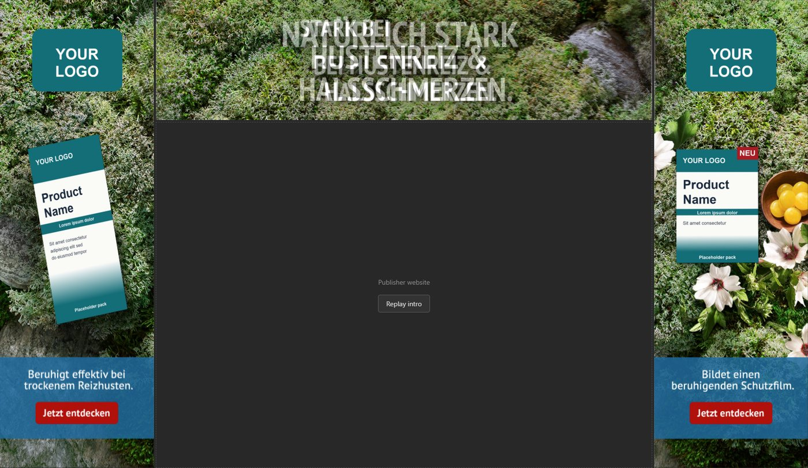

# Zadanie rekrutacyjne We The Folks: Gut Run i Fireplace

**Dwie reklamy rich media w czystym HTML, SCSS i nowoczesnym JavaScripcie (GSAP do animacji, bez frameworków): mobilna mini gra „tap to jump" („Gut Run") oraz trzyczęściowy, animowany skin desktopowy („Fireplace"). Zadanie: Junior Frontend Engineer, SF-FE-01-BAM.**


[🇬🇧 English](README.md) | 🇵🇱 Polski

Uzasadnienie głównych wyborów jest w [DECISIONS.pl.md](DECISIONS.pl.md).

---

## Dwie reklamy

| Wariant | Folder | Format | Waga po wysłaniu (limit 3 MB) |
| --- | --- | --- | --- |
| **A: Gut Run**, mobilna gra | [`variant-a-game`](variant-a-game) | projekt 360×640 px CSS, skalowany do telefonu | **1,45 MB** |
| **B: Fireplace**, skin desktopowy | [`variant-b-fireplace`](variant-b-fireplace) | top 1032×250, lewy i prawy 320×975 px CSS | **0,50 MB** lewy, **0,55 MB** prawy, **0,83 MB** top |

---

## Uruchomienie lokalne

Wymaga Node.js 18 lub nowszego (testowane na 24). Skompilowany CSS jest w repozytorium, więc `npm install` pobiera tylko serwer statyczny i Sass.

```bash
cd variant-a-game        # albo: cd variant-b-fireplace
npm install
npm start
```

| Wariant | Adres | Dodatki |
| --- | --- | --- |
| A | <http://localhost:3000> | `?debug=1` rysuje hitboxy i małe HUD (fps, najgorsza klatka, stan audio) |
| B | <http://localhost:3000/preview.html> | `?debug=1` nakłada `design/layout.png` na 50% (klawisz `O` przełącza); przycisk **Replay intro** |

Wariant A na telefonie otwórz przez adres LAN komputera (np. `http://192.168.1.10:3000`). Audio wymaga serwera, bo przeglądarki blokują `fetch` na `file://`. Po zmianie SCSS uruchom `npm run build:css`.

---

## Wariant A: Gut Run

Mobilna reklama pełnoekranowa z grą w stylu Flappy Bird. Gracz prowadzi uśmiechniętą kupkę przez stylizowane jelito i omija 15 przeszkód (bakterie i słowa takie jak „Stress" czy „Tabu"). Każda przeszkoda pojawia się dokładnie raz w jednym przejściu.

<p>
  
  &nbsp;
  
  &nbsp;
  
  &nbsp;
  
</p>

- **Start i rozgrywka**: animowane intro, pierwsze dotknięcie startuje grę po krótkim przewinięciu „get ready". Stała pozycja gracza, skok po dotknięciu, grawitacja, prędkość przewijania rośnie od 100 do 130 px/s.
- **Uczciwe kolizje**: hitboxy powstają z maski alfa każdego sprite'a, a nie z jego prostokąta. Na 108 000 sprawdzonych pozycji żadna śmierć nie nastąpiła dalej niż 2 px od widocznego dotknięcia.
- **Endcardy**: porażka (CTA i replay) i wygrana (konfetti, CTA), z animowanym wejściem elementów po kolei. Replay czyści wszystko: bez zostawionych timerów, podwójnej prędkości i zdublowanych dźwięków.
- **Dźwięk** (Web Audio API): pętla muzyki, uderzenie, porażka, wiwat i oklaski, startuje dopiero po pierwszym geście, z zapamiętywanym wyciszeniem.
- **Pauza** przy `visibilitychange` dla gry, dźwięku i animacji.
- **Responsywność**: skaluje się do każdego ekranu telefonu (od 320×568 do 430×932) bez deformacji. `prefers-reduced-motion` zastępuje animacje ozdobne stanem końcowym.

**Tryb debug** (`?debug=1`) rysuje hitboxy:



**Sprawdzone na:** Android Infinix Note 30 Pro w Chrome (60 fps, najgorsza klatka 17 ms, kilka gubionych klatek na starcie, gdy dekodują się sprite'y), iPhone w Safari (działa, razem z dźwiękiem) oraz Chrome desktop z dławieniem CPU i botami grającymi (wygrana, porażka, replay, pauza, reduced motion).

---

## Wariant B: Fireplace

Trzy osobne kreacje (`top.html`, `left.html`, `right.html`) obramowujące stronę wydawcy. `preview.html` układa je obok siebie w iframe'ach, jak w `design/layout.png`, z pustym obszarem na stronę.



- **Układ co do piksela**: warstwy leżą w pozycji i na 50% rozmiaru assetów 2x, a pozycję CTA zmierzyłem z designu.
- **Ciągłe tło**: pre-cuty tła zachowują produkt jak w designie, a cienkie paski wycięte z `bg-big.jpg` są wtapiane na szwach, żeby mech był jedną powierzchnią (szczegóły w [DECISIONS.pl.md](DECISIONS.pl.md#wariant-b-fireplace)).
- **Intro** (ok. 4,6 s, trzy części zsynchronizowane): zoom tła, logo, panel tekstowy, copy, nagłówek budowany linia po linii, na końcu CTA. Animowane są tylko `transform` i `opacity`.
- **Pętla w tle**: powolny dryf tła i delikatny puls CTA, które po 30 sekundach się zatrzymują, a ticker GSAP idzie spać.
- **Zsynchronizowany start** trzech dokumentów przez `postMessage` (`?sync=1`, używane przez podgląd). Otwarta osobno część startuje od razu.
- **Clickout** na całej części, **`prefers-reduced-motion`** (od razu stan końcowy), **pauza** przy ukrytej karcie i podgląd, który sam skaluje się do okna.

**Intro, dwa momenty:**



**Nakładka debug** (`?debug=1`), design na 50% na wierzchu mojej wersji:



---

## Znane problemy i skróty

**Oba warianty**
- Brak testów automatycznych. Weryfikowałem skryptami w headless Chrome, na prawdziwych telefonach (wariant A) i ręcznie.
- Brak kroku budowania JavaScriptu: zwykłe skrypty ładowane po kolei, żeby reklamy były małe. Skompilowany CSS jest w repozytorium.
- Click tagi testowane tylko z domyślnym adresem, nie w prawdziwym ad serverze.

**Wariant A**
- Zaprojektowany na telefony w pionie. W poziomie lub na tablecie gra zachowuje kształt 9:16 z granatowymi bokami.
- Trasa przeszkód jest stała (ręcznie dostrojona i zwalidowana), więc każde przejście wygląda tak samo.

**Wariant B**
- **Asset nagłówka na topie nie zgadza się z designem.** `layout.png` ma „NATÜRLICH STARK / BEI HUSTENREIZ & / HALSSCHMERZEN.", a dostarczony `top/hl.png` ma „STARK BEI / HUSTENREIZ & / HALSSCHMERZEN.". Użyłem assetu w takiej formie, jak go dostałem, więc nakładka debug pokazuje dwa nachodzące na siebie nagłówki.
- **Kilka assetów PNG-8 nie miało przezroczystości** (`box.png`, `cta.png`, oba `hl.png`). `tools/fix-alpha.py` ją przywraca. Krycie panelu (0,8) i wygładzanie krawędzi tekstu zostały odtworzone, więc są bliskie, ale nie dokładne.
- **`bg-big.jpg` nie pasuje do pre-cutów tła** (inna kolorystyka i produkt), więc używam go tylko do pasków na szwach.
- **Produkt jest wypalony w tle**, więc nie może wjechać sam; intro opiera się na zoomie i pojawianiu się tła.
- Paski szwów są statyczne, gdy tło pod nimi zoomuje, więc w ich 64-pikselowej strefie wtapiania można zauważyć lekki ruch.
- 4 px odstępu między częściami w podglądzie to założenie z szerokości `bg-big.jpg` (1680 px).
- Testowane tylko w Chrome, nie w Safari ani Firefoksie.

---

## Co zrobiłbym dalej

- Dodałbym testy Playwright: bota, który wygrywa i przegrywa w wariancie A, oraz kontrolę czasu klatek obu reklam.
- Wariant A: kilka tras przeszkód, rampę trudności przez poziomy, układ poziomy i lżejszą muzykę (to połowa wagi reklamy).
- Wariant B: poprosiłbym projektanta o czyste tło bez produktu, żeby mógł wjeżdżać osobno, wymienił uszkodzone PNG-8 na poprawne eksporty i dodałbym pauzę dla reklamy przewiniętej poza ekran.
- Spakowałbym każdą reklamę do osobnego zipa, przetestował click tagi w prawdziwym ad serverze i sprawdził Safari oraz Firefoksa.

---

## Notka o AI

Kroki i decyzje zaplanowałem sam, a **Claude Code** wykorzystałem do implementacji: szkieletów plików, narzędzi (generator hitboxów z maski alfa, walidator trasy, skrypty headless Chrome grające w grę i robiące zrzuty) i przeglądu mojego kodu. Wszystko, co wygenerował, przeczytałem i przetestowałem.

Gdzie się mylił i co poprawiłem:
- **Pierwszy skok zabijał gracza.** Na starcie brakowało zapasu miejsca, więc pierwsze dotknięcie wpadało w górną granicę. Dodałem osobną, łagodniejszą `startVelocity`.
- **Ręcznie ułożona trasa była zbyt gęsta**, żeby dało się ją uczciwie przejść. Zastąpiłem ją optymalizatorem i walidatorem (`tools/check-course.py`), który sprawdza każdą lukę względem fizyki.
- **Hitboxy tekstów były niesprawiedliwe.** Analiza piksele kontra prostokąty pokazała śmierci daleko od jakiegokolwiek dotknięcia, więc je przegenerowałem.
- **Błędne twierdzenie o rozmiarze.** Powiedział, że muzyka przekroczy 3 MB wariantu A, a była już policzona. Zmierzyłem prawdziwą wagę skryptem.
- **Tło wariantu B.** Założenie, że `bg-big.jpg` to po prostu złożone trzy tła, było fałszywe: zszycie pre-cutów pokazało szew, a `bg-big.jpg` ma inny produkt. Użyłem rozwiązania hybrydowego (zobacz [DECISIONS.pl.md](DECISIONS.pl.md#wariant-b-fireplace)).

---

## Stack i struktura

| Warstwa | Technologia |
| --- | --- |
| Znaczniki i logika | HTML5, JavaScript ES6+ (zwykłe skrypty), bez frameworka |
| Style | Sass (SCSS), BEM (`block__element--modifier`), skompilowany CSS w repo |
| Animacja | GSAP 3.15 (`vendor/gsap.min.js`, licencja standardowa) |
| Audio | Web Audio API (wariant A) |
| Narzędzia | `sass`, `serve`; Python z Pillow do narzędzi na assetach |

```
.
├─ variant-a-game/
│  ├─ index.html · css/ · scss/ · js/ · assets/ · vendor/
│  ├─ tools/               # gen-hitboxes.py, check-course.py
│  └─ design/              # ekrany docelowe (nie są wysyłane)
├─ variant-b-fireplace/
│  ├─ left.html · right.html · top.html · preview.html
│  ├─ css/ · scss/ · js/ · assets/ · vendor/
│  ├─ tools/               # fix-alpha.py, slice-seams.py
│  └─ design/              # layout.png (nie jest wysyłany)
├─ docs/images/            # zrzuty ekranu do README
├─ README.md · README.pl.md
└─ DECISIONS.md · DECISIONS.pl.md
```

`design/`, `tools/` i `bg-big.jpg` nie są wskazywane przez żadną reklamę, więc nie wchodzą do jej wagi.
